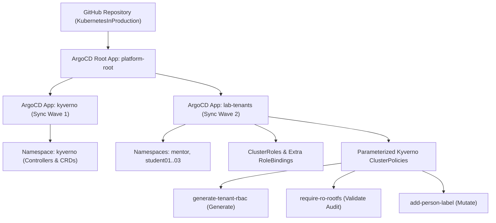

# Module 03 – Platform Engineering (GitOps з ArgoCD та Helm)

## Архітектура рішення

У третьому модулі інфраструктура кластера переведена під керування **GitOps (ArgoCD)** за патерном **App-of-Apps**, а всі політики Kyverno з Module 02 повністю параметризовані у єдиному Helm-чарті `charts/lab-tenants`.



---

## Структура директорії `module-03/`

- `setup-argocd.sh` — скрипт розгортання ArgoCD через Helm та реєстрації кореневого `Application` (`platform-root`).
- `argocd/`
  - `values-argocd.yaml` — конфігурація Helm-релізу ArgoCD (`application.resourceTrackingMethod: annotation`, `server.insecure: true`).
  - `root-app.yaml` — кореневий `Application` (`platform-root`), який стежить за папкою `module-03/argocd/apps` у Git-репозиторії.
  - `apps/kyverno.yaml` — дочірній `Application` (Sync Wave `1`) для управління життєвим циклом самого Kyverno.
  - `apps/lab-tenants.yaml` — дочірній `Application` (Sync Wave `2`) для розгортання єдиного параметризованого чарту `module-03/charts/lab-tenants`.
- `charts/lab-tenants/` — єдиний параметризований Helm-чарт для тенантів, RBAC та політик Kyverno:
  - `values.yaml` — усі налаштування студентів, ментора, RBAC та параметри кожної політики (`failureAction`, `severity`, `excludeNamespaces`, `rules`, `labelKey` тощо).
  - `templates/_helpers.tpl` — стандартні шаблони імен та лейблів Helm (`lab-tenants.labels`).
  - `templates/namespaces.yaml` — генерація неймспейсів.
  - `templates/rbac-base.yaml` — базові `ClusterRole`, агрегація прав для Kyverno та кастомні `RoleBinding`.
  - `templates/kyverno-generate-rbac.yaml` — параметризована політика генерації `ServiceAccount`, `Secret` та `RoleBinding`.
  - `templates/kyverno-validate-ro-rootfs.yaml` — параметризована політика перевірки `readOnlyRootFilesystem`.
  - `templates/kyverno-mutate-person-label.yaml` — параметризована політика додавання лейбла `person` у циклі за правилами з `values.yaml`.

---

## Розгортання та перевірка

### 1. Встановлення ArgoCD та запуск GitOps
```bash
cd ~/KubernetesInProduction/module-03
./setup-argocd.sh
```

### 2. Перевірка стану ArgoCD Applications
```bash
kubectl get applications -n argocd
```

### 3. Доступ до веб-інтерфейсу ArgoCD
```bash
kubectl port-forward svc/argocd-server -n argocd 8080:80
```
Отримати пароль адміністратора:
```bash
kubectl -n argocd get secret argocd-initial-admin-secret -o jsonpath="{.data.password}" | base64 -d && echo
```
