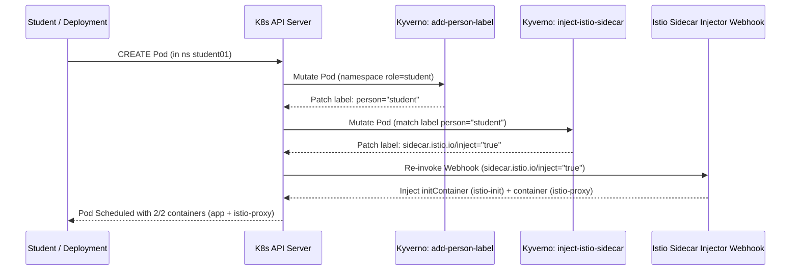

# Module 04 – Service Mesh (Istio Sidecar Mode & Kyverno Integration)

## Архітектура рішення

У четвертому модулі до GitOps-платформи додано **Istio Service Mesh** у класичному режимі **Sidecar** та інтегровано його з політиками **Kyverno**:

1. **Istio Service Mesh (Sidecar Mode via ArgoCD GitOps)**:
   - `istio-base` (Sync Wave `0`) — базові CRD та кластерні ролі Istio (`v1.30.6`).
   - `istiod` (Sync Wave `1`) — панель керування Istio (Control Plane: Pilot, CA, Sidecar Injector) у профілі `default` (режим sidecar) з налаштуванням `sidecarInjectorWebhook.reinvocationPolicy: IfNeeded`.
2. **Kyverno Mutate Policy (`inject-istio-sidecar-for-students`)**:
   - Відслідковує всі поди з лейблом `person: student` та автоматично додає на них лейбл `sidecar.istio.io/inject: "true"`.
   - Завдяки ланцюжку мутацій у Kubernetes Admission Control:
     1. Студент створює звичайний Pod у своєму неймспейсі (`student01`, `student02`, `student03`...) або будь-де з лейблом `person: student`.
     2. Політика Kyverno `add-person-label` додає `person: student` (якщо под створено в студентському неймспейсі).
     3. Політика Kyverno `inject-istio-sidecar-for-students` бачить `person: student` і додає `sidecar.istio.io/inject: "true"`.
     4.Завдяки `reinvocationPolicy: IfNeeded` Kubernetes API-сервер викликає `istio-sidecar-injector` MutatingWebhook, який інжектить ініціалізаційний контейнер `istio-init` та sidecar-контейнер `istio-proxy` (Envoy).
     5. Поди ментора (`person: mentor`) та системні поди запускаються **без** `istio-proxy`.



---

## Структура файлів

- `module-03/argocd/apps/istio-base.yaml` — ArgoCD `Application` для Istio CRDs.
- `module-03/argocd/apps/istiod.yaml` — ArgoCD `Application` для Istio Control Plane (`istiod`) у режимі sidecar.
- `module-04/charts/lab-tenants/` — оновлений єдиний Helm-чарт (`v0.3.0`), що включає шаблон `templates/kyverno-mutate-istio-sidecar.yaml`.
- `module-04/setup-istio.sh` — скрипт швидкого застосування ArgoCD-додатків Istio та оновлення чарту.
- `module-04/verify-service-mesh.sh` — автоматичний тестовий набір (перевіряє Istio Control Plane, ArgoCD Sync/Health та інжекцію `istio-proxy` у поди з `person: student`).

---

## Запуск та перевірка

```bash
cd ~/KubernetesInProduction/module-04
./setup-istio.sh
./verify-service-mesh.sh
```
