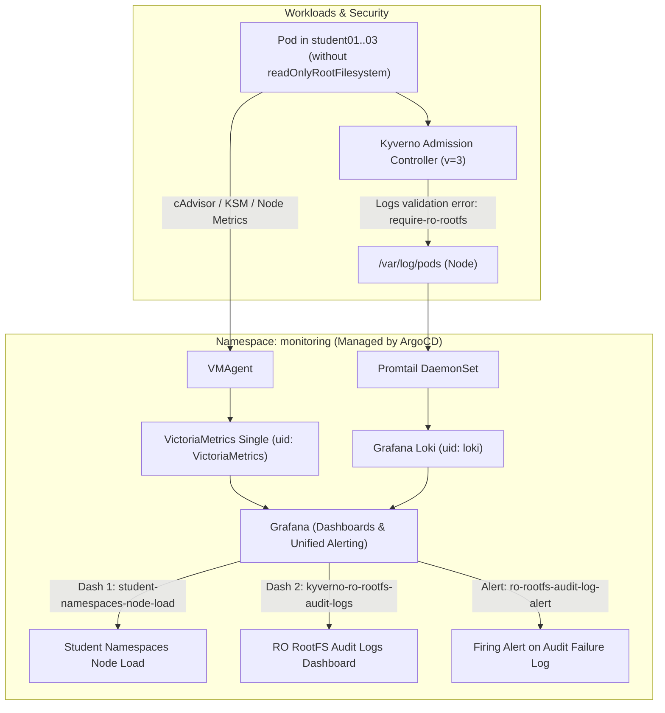

# Module 05 – Observability & Troubleshooting

## Архітектура рішення (VictoriaMetrics + Loki + Grafana via GitOps)

У п'ятому модулі в кластер розгорнуто легковаговий Production-ready стек моніторингу та логування (**VictoriaMetrics + Grafana Loki + Promtail + Grafana**), який повністю керується через **ArgoCD GitOps**:

1. **Метрики та візуалізація (`vm-k8s-stack` у неймспейсі `monitoring`)**:
   - **VictoriaMetrics Single (`vmsingle`)** — високопродуктивна TSDB, сумісна з PromQL, яка споживає у 3–4 рази менше оперативної пам'яті, ніж класичний Prometheus.
   - **VMAgent (`vmagent`)** — збирає метрики з kubelet, cAdvisor, `node-exporter`, `kube-state-metrics`, Kyverno та Istio.
   - **VMAlert (`vmalert`) + Alertmanager (`vmalertmanager`)** — обчислення правил `VMRule` та маршрутизація сповіщень.
   - **Grafana (`vmstack-grafana`)** — візуалізація дашбордів та виконання правил **Grafana Unified Alerting** (з увімкненими sidecar-контейнерами для автоматичного підвантаження `grafana_dashboard: "1"`, `grafana_datasource: "1"`, `grafana_alert: "1"`).
2. **Збір та агрегація логів (`loki-stack` у неймспейсі `monitoring`)**:
   - **Promtail** — DaemonSet на вузлі кластера, який читає контейнерні логи всіх подів (`/var/log/pods/...`) та відправляє їх у Loki.
   - **Grafana Loki (`loki-0`)** — система індексації та пошуку логів за допомогою мови запитів `LogQL`.
3. **Dashboards-as-Code & Alerts-as-Code (`module-05/charts/observability`)**:
   - **Дашборд 1 (`Student Namespaces - Node Load & Resource Usage`, UID: `student-namespaces-node-load`)**:
     - Відстежує частку CPU та RAM ноди, яку споживають студентські неймспейси (`student01`, `student02`, `student03`, `student*`).
     - Показує динаміку використання CPU (Cores), Memory Working Set (Bytes), мережевого трафіку (RX/TX) та дискового простору контейнерів у розрізі кожного студентського неймспейсу.
   - **Дашборд 2 (`Kyverno Security Audit - Read-Only RootFS Violations`, UID: `kyverno-ro-rootfs-audit-logs`)**:
     - Відображає кількість сповіщень у логах про непроходження аудиту `require-ro-rootfs` (`readOnlyRootFilesystem`), графік частоти порушень у часі та живий потік логів із Loki з деталями кожного порушення (назва пода, неймспейс, шлях у маніфесті).
   - **Алярм (`ReadOnlyRootFilesystem Audit Violation in Pod Logs`, UID: `ro-rootfs-audit-log-alert`)**:
     - Правило Grafana Unified Alerting виконує LogQL-запит до Loki:
       ```logql
       sum(count_over_time({namespace="kyverno"} |= "require-ro-rootfs" |= "readOnlyRootFilesystem" |= "validation error" [5m]))
       ```
     - Автоматично переходить у стан **`Firing` (`Alerting`)**, щойно в логах з'являється запис про непроходження аудиту `readOnlyRootFilesystem`.
     - Додатково налаштовано метричний `VMRule` (`kyverno-ro-rootfs-audit-violation`) для `vmalert` / `Alertmanager`.



---

## Структура файлів

- `module-03/argocd/apps/vm-k8s-stack.yaml` — ArgoCD `Application` для стеку VictoriaMetrics + Grafana.
- `module-03/argocd/apps/loki-stack.yaml` — ArgoCD `Application` для Grafana Loki + Promtail.
- `module-03/argocd/apps/observability-config.yaml` — ArgoCD `Application` для чарту дашбордів та алярмів.
- `module-05/charts/observability/` — Helm-чарт із декларативними дашбордами та правилами алертингу:
  - `templates/dashboard-student-namespaces-load.yaml`
  - `templates/dashboard-ro-rootfs-audit-logs.yaml`
  - `templates/alert-ro-rootfs-audit-logs.yaml`
- `module-05/setup-observability.sh` — скрипт розгортання та перевірки готовності стеку.
- `module-05/verify-observability.sh` — автоматичний E2E-тест (18 перевірок).

---

## Запуск, перевірка та доступ до Grafana UI

```bash
cd ~/KubernetesInProduction/module-05
./setup-observability.sh
./verify-observability.sh
```

Для перегляду дашбордів та алярмів у браузері:
```bash
kubectl port-forward svc/vmstack-grafana -n monitoring 3000:80
```
- **URL:** `http://localhost:3000`
- **Логін:** `admin`
- **Пароль:** `admin`
